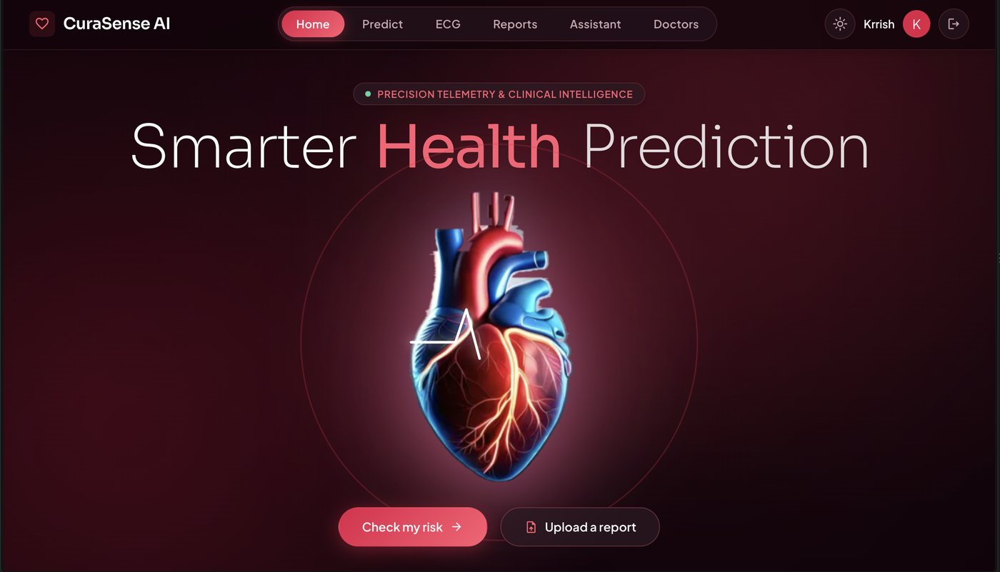
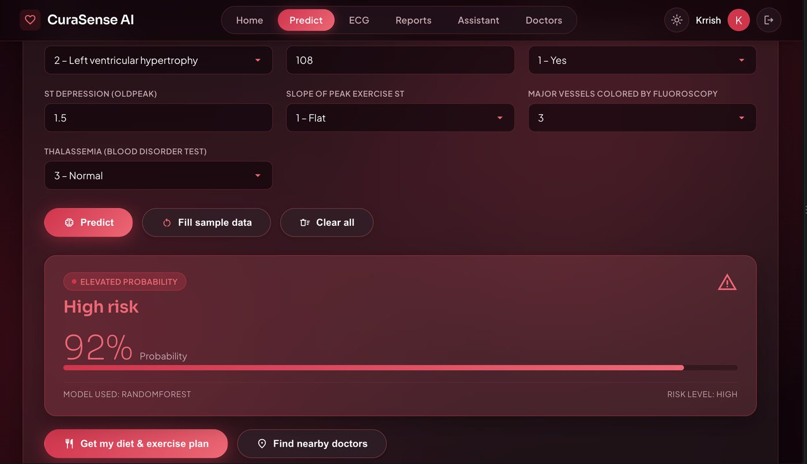
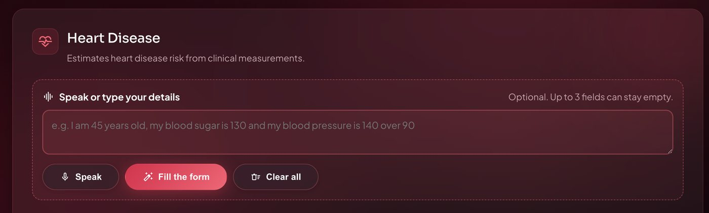
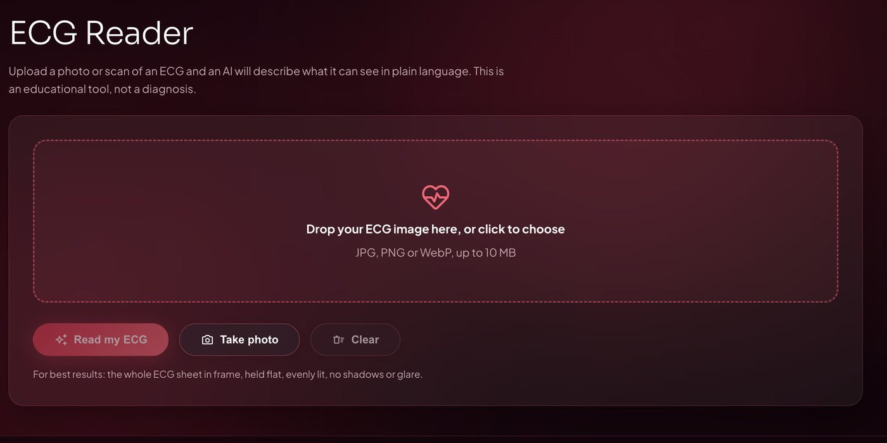
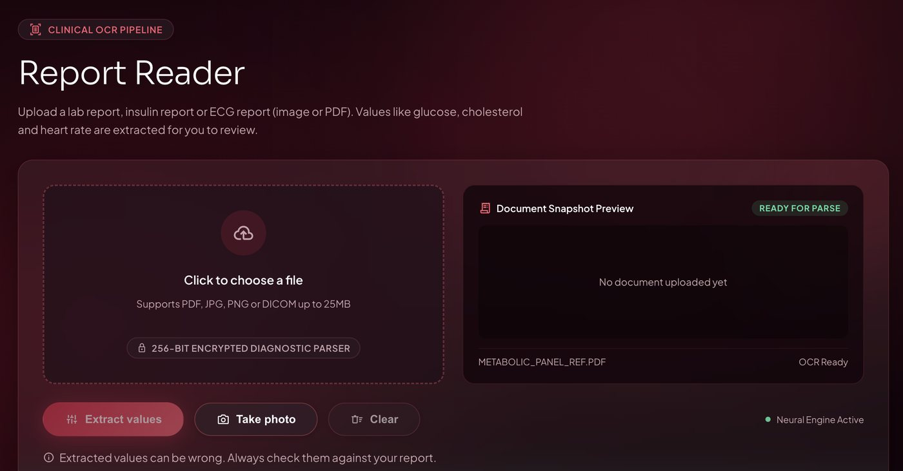
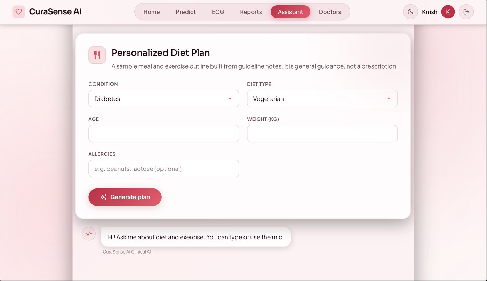
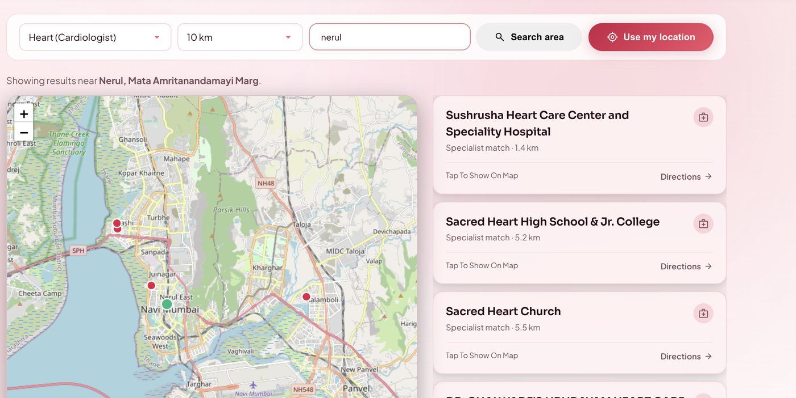

<div align="center">

# 🩺 CuraSense AI

**Smarter health prediction: ML risk models, AI report reading and a guideline-based health assistant in one web app.**

Built for the **CodeAlpha Machine Learning Internship**

[**Live demo**](https://code-alpha-disease-prediction-sigma.vercel.app) · [Backend API](https://codealpha-diseaseprediction-yx30.onrender.com) · [Features](#-features) · [Run locally](#-run-it-locally)




</div>

> ⚠️ **Educational project only. CuraSense AI is not a medical device and does not give medical advice or a diagnosis.** Always talk to a qualified doctor about your health.

> ⏱️ The live demo runs on free hosting. If nobody has used it for a while, the **first request can take 30 to 60 seconds** while the server wakes up.

---

## ✨ Features

| | Feature | What it does |
|---|---|---|
| ❤️ | **Disease risk prediction** | Trained ML models estimate the risk of **heart disease**, **diabetes** and **breast cancer** (benign or malignant) from clinical measurements. |
| 🎙️ | **Voice and text form filling** | Say or type *"I am 45, my blood sugar is 130 and my BP is 140 over 90"* and the form fills itself. |
| 📄 | **Report Reader** | Upload or photograph a lab report (image or PDF). Values are extracted and the AI explains them in plain language with a low, moderate or high concern level. |
| 📈 | **ECG Reader** | Upload or photograph an ECG and the AI describes what it can see in simple words. |
| 🥗 | **Diet and exercise assistant** | Ask questions by text or voice, or generate a sample diet and exercise plan. Answers are grounded in guideline notes (RAG), and general-knowledge answers are labelled as such. |
| 🗺️ | **Nearby doctors** | Find specialists (such as cardiologists) near you or near any area you search for, with a map and directions. |
| 📱 | **Mobile friendly** | Responsive layout, plus a **Take photo** button that opens the phone camera for reports and ECGs. |
| 🌗 | **Light and dark theme** | One-tap theme switch. |
| 🔐 | **Accounts** | Register and log in. All prediction, AI and map endpoints require a login token. |

---

## 📸 Screenshots

### Risk prediction
Fill the form (or use *Fill sample data*) and get a risk level, probability and the model used, with shortcuts to a diet plan and nearby doctors.



### Speak or type your details


### ECG Reader


### Report Reader


### Assistant and diet plan (light theme)


### Find nearby doctors


---

## 🧠 How it works

CuraSense AI keeps two kinds of intelligence separate on purpose:

1. **Classic machine learning (the prediction models).** For each disease, Logistic Regression, SVM, Random Forest and XGBoost are trained and tuned with `GridSearchCV` (5-fold stratified cross-validation). The best model per disease is saved with `joblib` and served by the API. The result card always shows which model produced the answer.
2. **LLM features (everything else).** The Report Reader, ECG Reader, voice form filling, assessment and the assistant use Gemini, with Groq as an automatic fallback if Gemini is busy. The assistant uses retrieval over a folder of guideline notes (`backend/knowledge`) so answers stay grounded.

```
React + TypeScript (Vercel)
        │  HTTPS + login token
        ▼
FastAPI (Render) ──► ML models (joblib): heart · diabetes · breast cancer
        ├──────────► Gemini → Groq fallback: reports · ECG · voice · assistant · diet plan
        ├──────────► Guideline notes + embeddings (RAG)
        ├──────────► Overpass / Nominatim: nearby doctors
        └──────────► Supabase PostgreSQL: user accounts
```

### Inputs the models use

| Disease | Inputs |
|---|---|
| Heart disease | age, sex, chest pain type, resting blood pressure, cholesterol, fasting blood sugar, resting ECG, max heart rate, exercise angina, ST depression, ST slope, major vessels, thalassemia (13 features) |
| Diabetes | pregnancies, glucose, blood pressure, skin thickness, insulin, BMI, diabetes pedigree function, age (8 features) |
| Breast cancer | mean radius, texture, perimeter, area, smoothness, compactness, concavity, concave points, symmetry, fractal dimension (10 features) |

Run `python train.py` in `backend/` to retrain. It prints the cross-validated comparison of all four models for each disease.

---

## 🛠️ Tech stack

| Layer | Tools |
|---|---|
| ML | Python, pandas, scikit-learn, XGBoost, joblib |
| Backend | FastAPI, Uvicorn, PyJWT, psycopg2 |
| AI | Google Gemini (with model fallbacks), Groq fallback, embeddings-based retrieval |
| Frontend | React 19, TypeScript, Vite, React Router, Axios, interactive OpenStreetMap map |
| Data | Supabase PostgreSQL (accounts), SQLite for local development |
| Maps | OpenStreetMap: Overpass with a Nominatim fallback, proxied through the backend |
| Hosting | Render (API) and Vercel (frontend) |

---

## 📁 Project structure

```
CodeAlpha_DiseasePrediction/
├── backend/
│   ├── main.py          # FastAPI app, routes, CORS
│   ├── auth.py          # register / login / token, Postgres or SQLite
│   ├── extras.py        # report reader, ECG reader, voice fill, assessment
│   ├── rag.py           # guideline retrieval, assistant, diet plan
│   ├── places.py        # nearby doctors (Overpass + Nominatim fallback)
│   ├── train.py         # trains and compares the ML models
│   ├── schemas.py       # request models
│   ├── models/          # saved models (joblib)
│   ├── knowledge/       # guideline notes for the assistant
│   └── requirements.txt
└── frontend/
    └── src/
        ├── pages/       # Home, Predict, ECG, Reports, Assistant, Doctors, Login
        ├── components/  # Navbar, PredictionForm, VoiceFill, DietPlan ...
        ├── diseases.ts  # form fields and sample data per disease
        └── index.css    # theme and responsive styles
```

---

## 🚀 Run it locally

You need **Python 3**, **Node.js 18+** and API keys for Gemini (and optionally Groq).

### 1. Backend

```bash
cd backend
python3 -m venv venv
source venv/bin/activate
pip install -r requirements.txt
```

Create `backend/.env`:

```env
GEMINI_API_KEY=your-gemini-key
JWT_SECRET=any-long-random-string

# optional
GROQ_API_KEY=your-groq-key
GROQ_MODEL=a-groq-model-name
GEMINI_MODEL=gemini-3.5-flash
DATABASE_URL=postgresql://...      # leave out to use local SQLite
CORS_ORIGINS=http://localhost:5173
```

Start the server (optionally run `python train.py` first to retrain the models):

```bash
uvicorn main:app --reload --port 8000
```

### 2. Frontend

```bash
cd frontend
npm install
npm run dev
```

Open the address Vite prints, usually <http://localhost:5173>. The frontend talks to `http://127.0.0.1:8000` by default. To point it somewhere else, set `VITE_API_URL` in `frontend/.env`.

### 3. Try it with sample data

| Test | Values | Expected |
|---|---|---|
| Heart | Age 67, male, chest pain 3 (asymptomatic), BP 160, cholesterol 286, ECG 2, max HR 108, exercise angina yes, oldpeak 1.5, slope 1 (flat), vessels 3, thal 3 | High risk |
| Diabetes | Pregnancies 1, glucose 85, BP 66, skin 29, insulin 94, BMI 26.6, pedigree 0.351, age 31 | Low risk |
| Breast cancer | Radius 17.99, texture 10.38, perimeter 122.8, area 1001, smoothness 0.1184, compactness 0.2776, concavity 0.3001, concave points 0.1471, symmetry 0.2419, fractal dim 0.07871 | Malignant |

Each form also has a **Fill sample data** button.

---

## ☁️ Deployment

- **Backend:** Render web service with *Root Directory* set to `backend`. Set the environment variables above, plus `DATABASE_URL` (Supabase *Session pooler* connection string) and `CORS_ORIGINS` (your frontend URL). Render redeploys automatically when files under `backend/` change.
- **Frontend:** Vercel project with *Root Directory* set to `frontend` and `VITE_API_URL` pointing to the Render URL. `vercel.json` rewrites all routes to `index.html` so page refreshes work.
- **Accounts:** stored in Supabase PostgreSQL. No manual schema step is needed because the table is created on first start.

---

## 🔒 Security notes

- Passwords are hashed with PBKDF2 and never stored in plain text.
- Login returns a signed token valid for 7 days. Prediction, AI, extras and map routes require it.
- The token is only sent to this app's own API, never to third-party services.
- API keys live in environment variables, not in the repository.

---

## ⚠️ Limitations

- Predictions are statistical estimates from small, classic research datasets. They are **not** validated for real clinical use.
- The ECG Reader and Report Reader use a general-purpose AI. They can misread an image or a value, so always check the extracted values against the original report.
- The AI assistant's general-knowledge answers (anything outside the guideline notes) are labelled and should be treated as general information only.
- Nearby-doctor results come from OpenStreetMap and may be incomplete or include non-medical places with similar names.
- Free hosting means a slow first load after idle time.

---

## 🙏 Acknowledgements

Built as part of the **CodeAlpha** Machine Learning internship. Datasets and ideas come from the classic public heart disease, Pima diabetes and Wisconsin breast cancer research datasets.

---

<div align="center">

**Educational purposes only. Not medical advice or a diagnosis.**

Made by [Shreya Mhatre](https://github.com/shreya09032006)

</div>
